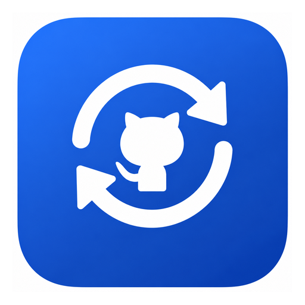

<div align="center">



# GitHub 账号切换器

一键切换 GitHub 账号，**浏览器和命令行同时切换**。

切换后你日常用的那个 Chrome 就是这个账号，而书签、历史、扩展全部原样保留。

</div>

---

## 它解决什么问题

有多个 GitHub 账号（个人号、公司号、客户委托号）时，Chrome 一次只能登录一个。切换账号就得退出登录、重登、过 2FA；命令行还容易推错身份。

这个工具让「切账号」变成**点一下**，并且同时处理三件事：

| 层面 | 做什么 | 影响 |
| --- | --- | --- |
| 浏览器 | 把目标账号的登录态写进你常用的 Chrome | 开 github.com 直接就是该账号 |
| 命令行认证 | `gh auth switch` | `git push` 用该账号 |
| 提交署名 | 改写 `user.name` / `user.email` | `git commit` 作者变该账号 |

写完会自动回读校验，不一致就中止，不会留下「认证是 A、署名是 B」的错乱状态。

## 功能

- **添加账号**：给出授权码 + 链接，自动打开浏览器，你登录后程序自动抓到账号
- **切换账号**：一键切换浏览器 + 命令行，支持撤销（自动备份原登录态）
- **创建 Token**：按需勾选权限，生成预填好的创建链接，粘回后自动校验权限
- **设置**：App-Bound 加密开关 + 环境自检

## 快速开始

### 使用现成版本

下载 `dist` 目录，双击 `GitHubSwitcher.exe`。**不需要安装 .NET 运行时**（已打包为自包含单文件）。

### 从源码构建

需要 [.NET 8 SDK](https://dotnet.microsoft.com/download/dotnet/8.0)。

```powershell
cd src/GitHubSwitcher

# 开发构建
dotnet build -c Release

# 发布为自包含单文件（目标机无需装运行时）
dotnet publish -c Release -r win-x64 --self-contained true `
  -p:PublishSingleFile=true -o ../../dist
```

## 环境要求

- Windows 10 / 11 x64
- Google Chrome（已安装即可，程序不会改动你原有配置）
- 可选：`git` 与 `gh` CLI（要用命令行切账号才需要）

## 工作原理

### 浏览器：直接改写 Chrome 的 cookie

Chrome 的 cookie 用 AES-256-GCM 加密，主密钥存在 `Local State` 里由 Windows DPAPI 保护。

程序读取源账号目录的密钥解出明文，再用**你日常 Chrome 的密钥**重新加密写入。因为两套密钥不同，必须真正解密后重加密，不能直接拷密文。

只执行一条 SQL：

```sql
DELETE FROM cookies WHERE host_key LIKE '%github%'
```

**除 github.com 的 cookie 外，一行数据都不碰。** 书签在 `Default\Bookmarks`，登录态在 `Default\Network\Cookies`，是两个独立文件 —— 这就是「切换不会丢书签」的技术原因，实测 SHA256 前后完全一致。

### 命令行：借力 gh

本机 git 的凭据助手指向 `gh auth git-credential`，所以只要 `gh` 认识某账号，https 推送就自动跟随。

### 无第三方依赖

- SQLite 直接 P/Invoke Windows 自带的 `winsqlite3.dll`
- 加密用 .NET 内置的 `AesGcm` / DPAPI

整个项目**没有一个 NuGet 包依赖**，离线可构建。

## 关于 App-Bound 加密

Chrome 正在推行更严格的 cookie 加密（App-Bound Encryption）。一旦启用，cookie 变成 `v20`，密钥由 Chrome 的 elevation service 保管并校验调用方身份 —— **外部程序无法解密，也无法降级成 v10**。

本工具的对策：

1. **设置 → 关闭 App-Bound 加密**：写入 Chrome 企业策略 `ApplicationBoundEncryptionEnabled=0`，提前把闸门关上
2. **设置 → 从 v20 修复并重置登录**：若已受影响，会清掉读不了的 v20 cookie 并阻止今后产生，代价是需要重新登录一次

> 建议现在就点一下「关闭」，而不是等到被影响后再重置。
>
> 副作用：Chrome 会显示「由贵单位管理」的提示，可随时用「恢复 Chrome 默认」移除。

## 数据与安全

| 内容 | 位置 | 保护 |
| --- | --- | --- |
| 账号列表 | `%APPDATA%\GitHubSwitcher\accounts.json` | 明文，仅账号名 + 邮箱 |
| Token | `%APPDATA%\GitHubSwitcher\secrets.bin` | Windows DPAPI 加密，绑定当前用户 |
| 登录态备份 | `%APPDATA%\GitHubSwitcher\browser-snapshots\` | 明文 cookie，仅本机可读 |
| 各账号隔离目录 | `%LOCALAPPDATA%\GitHubSwitcher\chrome\` | Chrome 自身加密 |

程序不保存任何账号密码，认证走 GitHub 官方设备授权流程。

**这些运行时数据都在用户目录，不在仓库里**，`.gitignore` 也已兜底。

## 已知限制

- **仅支持 Windows**（依赖 DPAPI、winsqlite3、注册表策略）
- **仅支持 github.com**（GitLab / Gitea 未实现）
- **换电脑需重新登录**：浏览器登录态由那台机器的密钥加密，无法跨机迁移。程序本体可以复制，登录态不能
- **创建 Token 需手动点一下**：GitHub 没有任何公开 API 允许第三方创建 PAT（实测 `POST /authorizations` 与所有 fine-grained 端点均返回 404）
- **切换前需关闭 Chrome**：Chrome 运行中会把 cookie 缓存到内存，可能回写覆盖

## 项目结构

```
src/GitHubSwitcher/
├── Models/            # Account、ScopeCatalog
├── Services/
│   ├── AbeService.cs           # App-Bound 加密检测与 v20 修复
│   ├── AccountStore.cs         # accounts.json 读写
│   ├── AppPaths.cs             # 路径管理
│   ├── BrowserProfileService.cs # 注入登录态 / 备份 / 还原
│   ├── ChromeCookieStore.cs    # DPAPI + AES-GCM cookie 读写
│   ├── ChromeLauncher.cs       # 浏览器启动
│   ├── GhCli.cs                # gh 集成
│   ├── GitConfig.cs            # git 署名
│   ├── GitHubApi.cs            # 设备流 + REST
│   ├── ProcessRunner.cs        # 外部命令执行
│   ├── SecureStore.cs          # DPAPI 凭据存储
│   └── SqliteDb.cs             # winsqlite3 P/Invoke
├── Assets/app.ico      # 应用图标（多尺寸）
├── MainWindow.xaml
├── SwitchPage.xaml     # 切换账号
├── AddAccountPage.xaml # 添加账号
├── TokenPage.xaml      # 创建 Token
└── SettingsPage.xaml   # 设置 / 自检
```

## 合规提醒

多账号仅用于正常用途（个人号 / 公司号 / 客户委托）。

用多账号刷 star、刷 issue、规避封禁或绕过配额违反 GitHub 条款。本工具不提供任何规避能力，也不做指纹伪装。

## License

MIT
